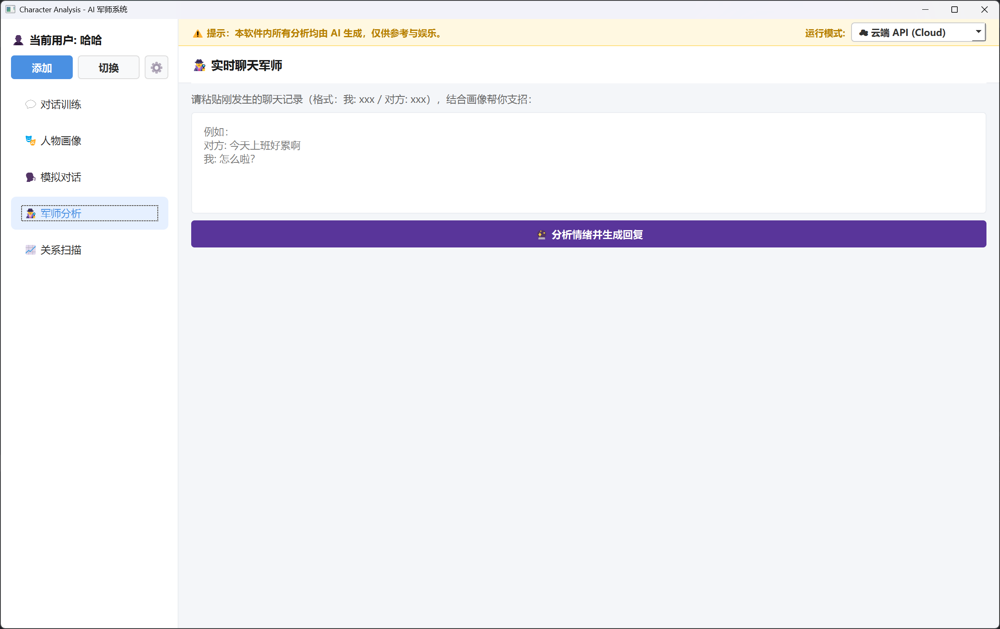
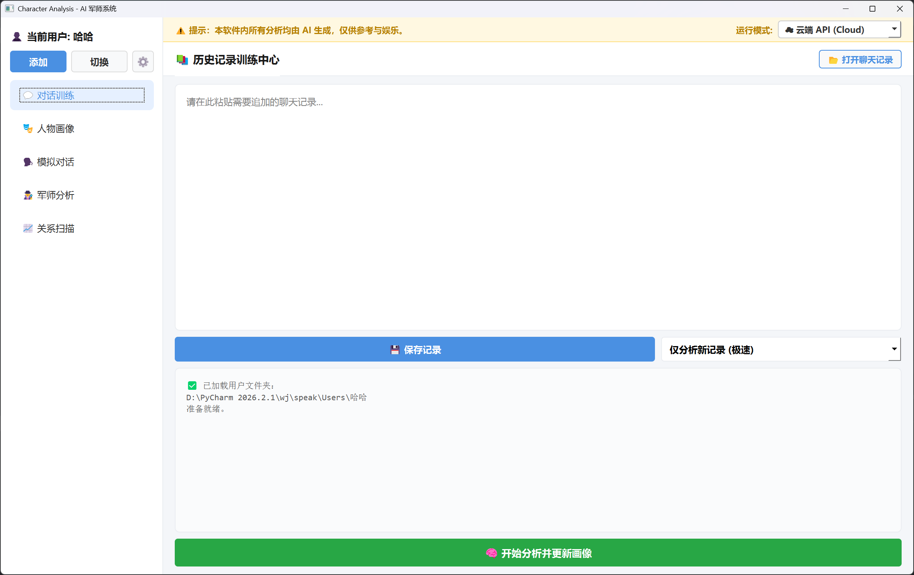
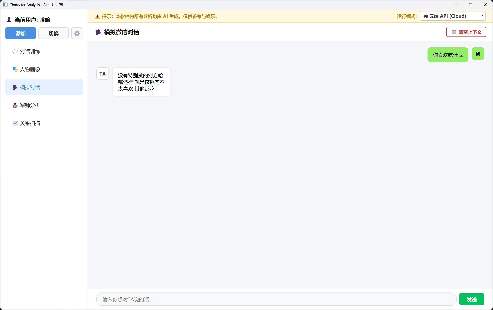
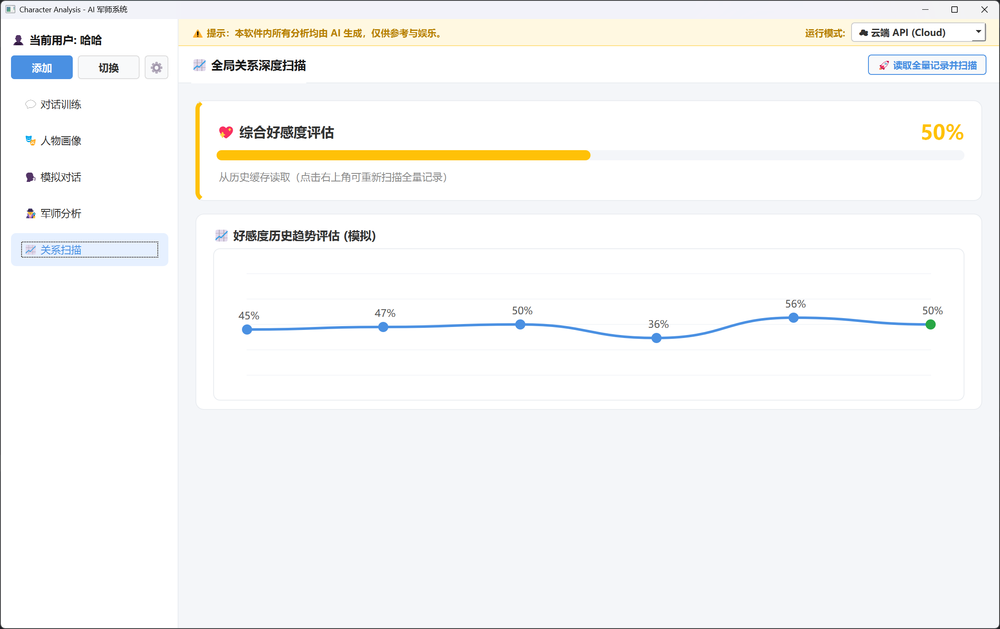

# 🎭 角色分析 (Character Analysis) - AI 军师系统


> ⚠️ **免责声明**：本工具所有数据均需用户**手动导入**（复制粘贴聊天记录），不直接读取、破解或解密任何微信本地数据库。所有 AI 生成的内容仅供参考与娱乐，请勿用于非法用途。

## 📸 界面预览

### 1. 历史记录训练中心


### 2. 人物深度画像


### 3. 模拟微信对话


### 4. 全局关系深度扫描


## ✨ 核心功能

- 💻 **双模驱动**：支持本地运行量化模型（默认支持 Qwen2-7B-Int4），也支持接入云端 API（如 DeepSeek、通义千问），一键切换，极速响应。
- 🎭 **人物画像**：增量合并对话，自动生成结构化的卡片式人物画像，重点特征自动高亮。
- 🕵️ **实时军师**：分析对方当前情绪，提供高情商回复话术。
- 🗣️ **模拟对话**：基于人物画像，扮演对方与你进行聊天测试。
- 📈 **关系扫描**：读取全量记录，预测 0-100% 的好感度，并绘制历史趋势折线图。

## 🚀 快速开始

### 1. 安装依赖
在终端运行以下命令安装所需环境：
```bash
pip install -r requirements.txt
2. 配置 API（推荐）
在根目录下新建 settings.json 文件，填入以下内容：

json
{
    "use_api": true,
    "api_key": "sk-填入你的API_KEY",
    "base_url": "https://api.deepseek.com",
    "model_name": "deepseek-chat"
}
提示：你也可以在软件界面点击左上角 ⚙️ 按钮，自动生成该文件。

3. 运行软件
bash
python ui/main.py
💻 本地模型说明
如果你想完全离线运行，需修改 `local_server.py` 和 `local_engine.py` 中的 `MODEL_PATH`，指向你本地的大模型目录（如 Qwen2-7B）。

⚡ 常驻推理服务（本地模式加速）
本地模式下，模型由 `local_server.py` 常驻加载一次，之后所有功能（画像分析 / 军师 / 模拟对话 / 关系扫描）通过
`local_engine.py` 复用同一份模型，不必每次点击都重新加载 7B 权重（实测首次约 30s，之后每次请求仅耗时生成时间）。
- 服务会在首次使用时自动拉起，无需手动启动；也可手动 `python local_server.py`。
- 空闲 15 分钟自动退出；关闭主界面时也会自动关闭，释放显存（可用环境变量 `LOCAL_SERVER_IDLE_TIMEOUT` 调整）。
- 若服务启动失败（如显存不足），会自动回退为单次加载模式，功能不受影响。

🤝 贡献与反馈
非常欢迎提交 Issue 或 Pull Request！如果你觉得这个项目有意思，不妨点个 ⭐️ Star 支持一下！
